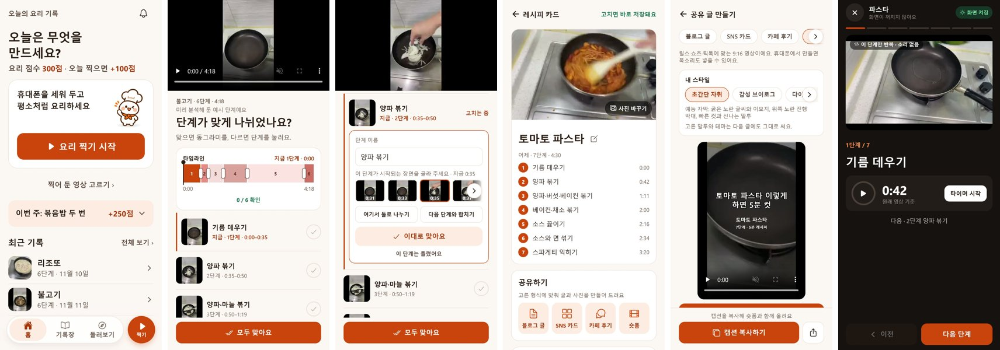
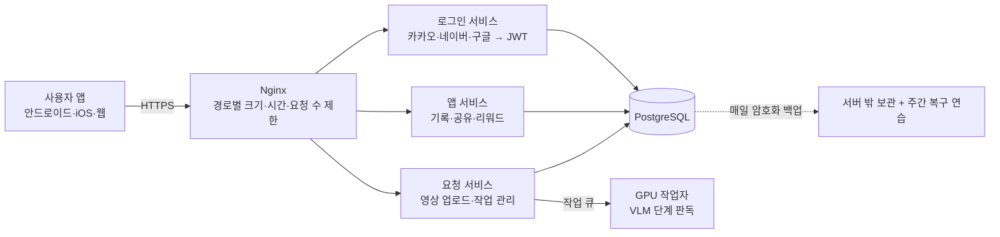

  

<h2 align="center">쿠킹테이블 (CookingTable)</h2>

  요리 영상을 올리면 AI가 단계별 레시피로 나눠 주고, 
  학습에 동의한 영상은 조리 로봇의 학습 데이터가 되는 서비스

  2학기 자율 프로젝트 · 기업연계(조리 로봇 기업 로보터블) · 2026.10.12 ~ 11.20 · 6인 팀

---

## 한눈에 보기

| 항목 | 내용 |
|---|---|
| 문제 | 조리 로봇이 동작 하나를 익히려면 단계·경계가 정확히 나뉜 실제 요리 영상이 많이 필요하다. 사람이 직접 라벨을 달면 영상 1시간에 수십 시간이 걸린다 |
| 해결 | 영상을 단계로 나누는 AI 파이프라인을 **요리하는 사람을 위한 앱**으로도 내놓았다. 사용자는 레시피를 얻고, 동의한 영상은 학습 데이터가 된다 |
| AI | 색 히스토그램 → 임베딩 → VLM 파인튜닝(Qwen, LoRA) 순서로 시도. 최종 모델은 외부 API 없이 10분 영상을 약 160원에 처리 |
| 서비스 | React Native(Expo) 앱 하나로 안드로이드·iOS·웹. 촬영 → 단계 확인·수정 → 레시피 카드 → 블로그 글·SNS 카드·숏폼 영상 공유 |
| 결과 | 최종 발표와 현장 시연 완료(수상 결과 발표 전) |
| 나의 역할 | **인프라 담당** — 팀 서버 네트워크·보안·배포·백업, 로그인 서비스(백엔드), 앱 화면 일부, 초기 AI 판독 실험 |

  
   홈 → 단계 확인 → 단계 수정 → 레시피 카드 → 공유 글·숏폼 → 요리 모드

## 서비스 흐름

1. 사용자가 요리 영상을 찍거나 고른다.
2. 서버가 영상을 받아 GPU 작업자에게 넘기고, 파인튜닝한 VLM이 장면을 보고 단계와 이름을 정한다.
3. 사용자는 타임라인에서 단계를 확인하고, 틀린 곳은 경계·이름을 고친다.
4. 레시피 카드로 저장하고 블로그 글·SNS 카드·숏폼 영상으로 공유한다.
5. 학습에 동의한 영상과 사람이 고친 단계는 다음 학습 데이터 후보가 된다.

## 기술 스택

| 영역 | 기술 |
|---|---|
| 앱 | React Native, Expo Router, TypeScript |
| 백엔드 | Spring Boot, Java 17, PostgreSQL, Flyway |
| 인프라 | AWS Lightsail(Ubuntu 24.04), Nginx, Let's Encrypt, UFW, fail2ban, systemd, age, GitLab CI(초안) |
| AI | Qwen VLM + LoRA(RunPod), Gemini API, Claude(선생 모델), OpenCV |
| 협업 | GitLab, Jira, 공용 작업 지도(axMap) |

## 나의 역할 — 인프라

> 팀에서 처음으로 서버를 맡았습니다. "열리면 끝"이 아니라 **밖에서 어떻게 보이는지 직접 확인하고, 바꾼 설정은 저장소에 사본으로 남기는 것**을 원칙으로 잡았습니다.

| 분야 | 한 일 |
|---|---|
| 🌐 네트워크 | 도메인·HTTPS(Let's Encrypt), Nginx 리버스 프록시, API 경로별 본문 크기·시간·요청 수 제한, IP 직접 접속 차단(444), 방화벽 두 겹(UFW + 클라우드 방화벽) |
| 🔐 로그인 서비스 | Spring Boot로 카카오·네이버·구글 로그인을 한 서비스로 모으고, RS256 JWT와 공개키(JWKS)를 발급. 갱신 토큰 회전·재사용 감지, PKCE, 휴대폰 앱용 1회용 code 교환, 계정 삭제 API |
| 🛡 보안 | OWASP Top 10:2025 기준 점검, SSH 계정 제한·root 로그인 차단, fail2ban 규칙 보강, 관리자 페이지 비밀번호 대입 제한, 커널 네트워크 설정 강화 |
| 💾 백업 | DB 매일 백업 → age로 암호화해 서버 밖 보관 → 매주 자동 복구 연습 |
| 🚀 배포 | 앱 웹 빌드 배포, CSP를 사이트용·앱용으로 분리, 배포 전용 제한 계정, GitLab CI/CD 구성안 |
| 📄 운영 문서 | 개인정보 처리방침·이용약관 작성과 공개, 서버 읽기 전용 점검 스크립트 |
| 📱 앱·AI | 앱 화면 다듬기(5060세대 기준 글자·누르는 영역), 판독 실패 처리, 초기 Gemini 판독 실험 |

자세한 선택 과정과 결과는 **[내가 한 일 — 문제와 선택](내가_한_일.md)** 에 정리했습니다.

## 링크

- 📝 벨로그 기록: [[자율] 요리 영상 레시피 서비스](https://velog.io/@bara0121/series)
- 💻 코드: 비공개 저장소(기업연계 프로젝트라 비공개로 보관)

  <a href="../README.md">📂 포트폴리오 목록으로</a>

