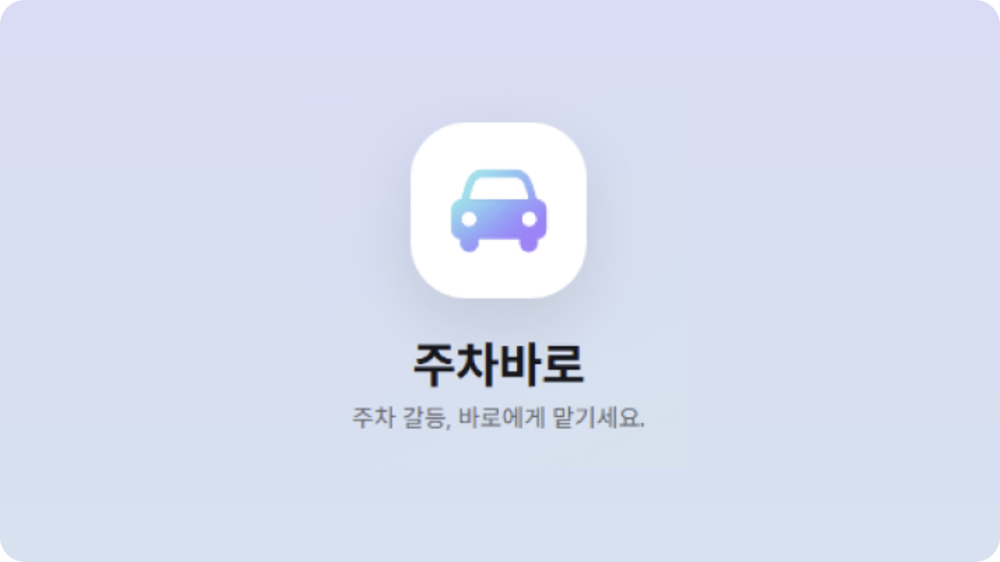

  

  SSAFY 15기에서 진행한 네 개의 프로젝트를 모았습니다. 
  표에서 프로젝트를 고르면 영상과 발표 장표부터 볼 수 있어요.

  <a href="https://github.com/jinmiri-dev">👋 프로필 · 수상 · 상장</a> &nbsp;·&nbsp;
  <a href="https://velog.io/@bara0121">📝 velog</a>

---

## 📂 프로젝트

<table>
  <tr><th width="30%">프로젝트</th><th width="24%">결과 · 역할</th><th>자료</th></tr>
  <tr><td> 🎬 <b>Pick & Go</b> AI 영화 추천 웹 서비스 1학기 관통 · 2026.06.22 ~ 06.26</td><td>🥇 최우수 팀장 · 프론트엔드 · 백엔드 · UI/UX</td><td><a href="./1학기_픽앤고_영화추천사이트">📄 프로젝트</a> · <a href="./1학기_픽앤고_영화추천사이트/내가_한_일.md">🙋 내 역할·판단</a> · <a href="https://velog.io/@bara0121/series/%EA%B4%80%ED%86%B5-AI-%EC%98%81%ED%99%94-%EC%B6%94%EC%B2%9C-%EC%84%9C%EB%B9%84%EC%8A%A4">✍️ 블로그</a> · <a href="https://pick-and-go-2z6d.onrender.com">서비스</a></td></tr>
  <tr><td> 🚗 <b>주차바로</b> AIoT 주차 관리 서비스 2학기 공통 · 2026.07.06 ~ 08.10</td><td>🥈 우수 AI · 추적 · 위반 판정</td><td><a href="./2학기_주차바로_AIoT#-영상-포트폴리오">🎬 영상·장표</a> · <a href="./2학기_주차바로_AIoT">📄 프로젝트</a> · <a href="./2학기_주차바로_AIoT/내가_한_일.md">🙋 내 역할·판단</a> · <a href="./2학기_주차바로_AIoT/Jira_작업_목록.md">Jira 44</a> · <a href="https://velog.io/@bara0121/series/%EC%98%81%EC%83%81-AI-%EC%8B%A4%EC%A0%84-%EB%85%B8%ED%8A%B8">✍️ 블로그</a> · <a href="https://lab.ssafy.com/s15-webmobile3-sub1/S15P11E202">GitLab</a></td></tr>
  <tr><td> 🌉 <b>GABOLLE(가볼래)</b> 부산 초개인화 여행 추천 앱 2학기 특화 · 2026.08.18 ~ 09.28</td><td>🥈 우수 · 반 2등 웹·앱 프론트엔드</td><td><a href="./2학기_가볼래_빅데이터_분산#-영상-포트폴리오">🎬 영상·장표</a> · <a href="./2학기_가볼래_빅데이터_분산">📄 프로젝트</a> · <a href="./2학기_가볼래_빅데이터_분산/내가_한_일.md">🙋 내 역할·판단</a> · <a href="./2학기_가볼래_빅데이터_분산/Jira_작업_목록.md">Jira 376</a> · <a href="https://velog.io/@bara0121/series/%ED%8A%B9%ED%99%94-%EB%B6%80%EC%82%B0-%EC%97%AC%ED%96%89-%EC%B6%94%EC%B2%9C-%EC%95%B1">✍️ 블로그</a> · <a href="https://lnkd.in/gu9tqb-W">Google Play</a> · <a href="https://lnkd.in/ghwvukiK">App Store</a></td></tr>
  <tr><td> 🧑‍🍳 <b>쿠킹테이블</b> 요리 영상 레시피 AI 서비스 · 기업연계 2학기 자율 · 2026.10.12 ~ 11.20</td><td>🎤 발표 완료 결과 발표 전 인프라 · 로그인 서비스 · 앱 화면</td><td><a href="./2학기_쿠킹테이블__기업연계#-홍보-영상">🎬 영상·장표</a> · <a href="./2학기_쿠킹테이블__기업연계">📄 프로젝트</a> · <a href="./2학기_쿠킹테이블__기업연계/내가_한_일.md">🙋 내 역할·판단</a> · <a href="./2학기_쿠킹테이블__기업연계/Jira_작업_목록.md">Jira 83</a> · <a href="https://velog.io/@bara0121/series/%EC%9E%90%EC%9C%A8-%EC%9A%94%EB%A6%AC-%EC%98%81%EC%83%81-%EB%A0%88%EC%8B%9C%ED%94%BC-%EC%84%9C%EB%B9%84%EC%8A%A4">✍️ 블로그</a></td></tr>
</table>

### 폴더마다 들어 있는 것

| 파일 | 내용 |
|---|---|
| `README.md` | 맨 위에 🎬 영상과 🖼 최종 발표 장표, 그 아래 팀이 쓴 프로젝트 README |
| `내가_한_일.md` | 제가 맡은 일, 부딪힌 문제마다 고민한 선택지(A안·B안·C안)와 고른 이유, 결과 |
| `Jira_작업_목록.md` | 제가 담당한 Jira 이슈를 분야별로 묶은 목록 (1학기 관통은 Jira 없이 진행) |

---

  <a href="https://github.com/jinmiri-dev">👋 프로필로 돌아가기</a> &nbsp;·&nbsp;
  <a href="https://velog.io/@bara0121">📝 velog</a>

