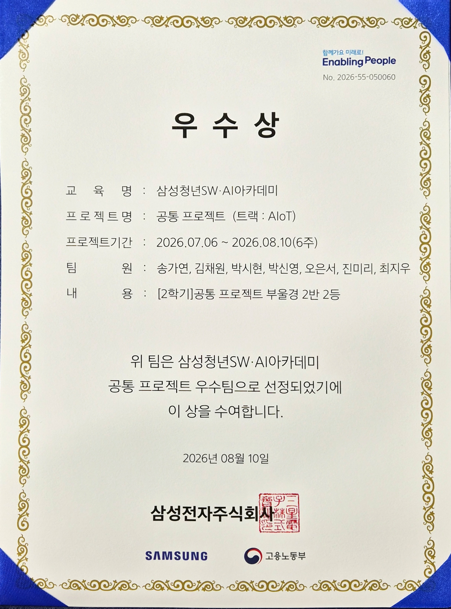
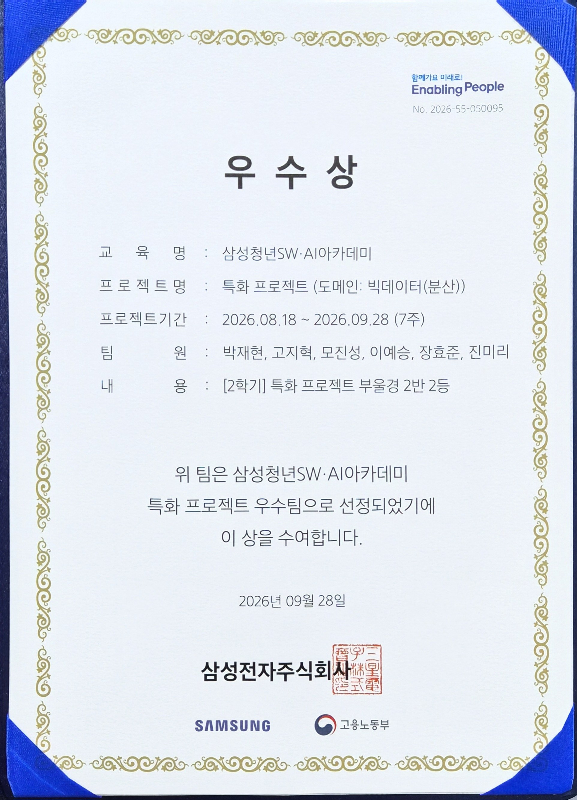

  

  SSAFY 15기에서 진행한 프로젝트와 활동, 수상 내역을 한곳에 모았습니다. 
  각 프로젝트 폴더에는 팀 README와 화면 시연, 설계 자료가 들어 있습니다.

  <a href="#-수상--활동">🏆 수상 · 활동</a> &nbsp;·&nbsp;
  <a href="#-상장">📜 상장</a> &nbsp;·&nbsp;
  <a href="#-프로젝트">📂 프로젝트</a>

---

## 🏆 수상 · 활동

| 구분 | 내용 | 역할 |
|:---:|---|---|
| 🙋 활동 | **SSAFY 부울경 1반 CA** (Class Ambassador) | 자치회 활동 |
| 🥇 최우수 | **광주 캠퍼스 SSAFY MeetUp! 쇼미더아이디어** · 상금 30만원 | 개발 언어 선택을 주제로 한 콩트 형식 발표 (5인 1팀) |
| 🥇 최우수 | **관통 프로젝트** · AI 영화 추천 서비스 Pick & Go | **팀장** |
| 🥈 우수 | **공통 프로젝트** · AIoT 주차 관리 서비스 주차바로 | AI 담당 |
| 🥈 우수 | **특화 프로젝트** · 부산 여행 추천 서비스 GABOLLE(가볼래) · 반 2등 | 프론트엔드 담당 |

## 📜 상장

<table>
  <tr>
    <td align="center" width="33%">
       
      <b>1학기 관통 프로젝트 최우수상</b> · Pick & Go
    </td>
    <td align="center" width="33%">
       
      <b>2학기 공통 프로젝트 우수상</b> · 주차바로
    </td>
    <td align="center" width="33%">
       
      <b>2학기 특화 프로젝트 우수상</b> · GABOLLE
    </td>
  </tr>
</table>

이미지를 누르면 원본 크기로 볼 수 있어요.

---

## 📂 프로젝트

<table>
  <tr>
    <td width="33%" valign="top">
      
      <h4>🎬 Pick & Go</h4>
      AI 영화 추천 웹 서비스 
      1학기 관통 · 2026.06.22 ~ 06.26  
      <a href="./1학기_픽앤고_영화추천사이트">📄 README</a> ·
      <a href="https://pick-and-go-2z6d.onrender.com">🔗 배포 사이트</a> ·
      <a href="https://github.com/jinmiri-dev/pick-and-go">💻 GitHub</a>
    </td>
    <td width="33%" valign="top">
      
      <h4>🚗 주차바로</h4>
      AIoT 주차 관리 서비스 
      2학기 공통 · 2026.07.06 ~ 08.10 (6주)  
      <a href="./2학기_공통프로젝트_주차바로">📄 README</a> ·
      <a href="https://lab.ssafy.com/s15-webmobile3-sub1/S15P11E202">💻 GitLab</a>
    </td>
    <td width="33%" valign="top">
      
      <h4>🌉 GABOLLE (가볼래)</h4>
      부산 초개인화 여행 추천 앱 
      2학기 특화 · 2026.08.18 ~ 09.28 (7주)  
      <a href="./2학기_가볼래_빅데이터_분산">📄 README</a> ·
      <a href="https://lnkd.in/gu9tqb-W">🤖 Google Play</a> ·
      <a href="https://lnkd.in/ghwvukiK">🍎 App Store</a> ·
      <a href="https://github.com/jinmiri-dev/gabolle_bigdata">💻 GitHub</a>
    </td>
  </tr>
</table>

### 🎬 Pick & Go · 관통 프로젝트 최우수

현재 감정과 영화 취향 유형인 **MVTI**를 바탕으로 영화를 추천하고, 감상 기록과 커뮤니티 활동까지 연결하는 **개인 맞춤형 영화 추천 서비스**입니다.

- **담당 역할**: 팀장 · 프론트엔드 · UI/UX · 데이터 구성. 전체 화면 디자인과 사용자 흐름을 설계하고, MVTI 결과·영화 달력·커뮤니티·배지·알림·픽키 챗봇 UI를 구현했습니다.
- **기술 스택**: `Django 5.2` `Vue 3` `Python` `SQLite` `TMDB API` `GMS API`

<b>주요 기능</b>

- 8문항 영화 취향 테스트를 통한 16가지 MVTI 유형 분석과 결과 카드 제공
- 오늘의 감정·명대사·MVTI를 반영한 AI 영화 추천과 추천 이유 안내
- 영화 탐색, 장르 필터, 랜덤 영화 뽑기, TOP10 개인화 랭킹
- 친구 취향 궁합과 함께 보기 좋은 영화 추천
- 리뷰·댓글·좋아요·알림·영화 달력을 통한 감상 기록 및 커뮤니티 경험

<b>🚀 발표 후 무료 배포 (2026.07.03)</b>

발표 이후에도 실제 접속 가능한 서비스로 완성하고자 무료 배포를 진행했습니다.

- **인프라**: Render(백엔드+프론트 통합 서빙) + Neon PostgreSQL
- **주요 작업**: SQLite→PostgreSQL 마이그레이션 · N+1 쿼리 최적화 · GMS→Gemini API 전환 · 반응형/모바일 UX 개선
- **Render 선택 이유**: Vercel(서버리스)은 Django 상시 구동 서버와 궁합이 안 맞고, Railway/Fly.io는 무료 티어가 사라져 카드 등록이 필요해짐

📝 코드로 다시 뜯어본 기록 → [velog [관통] AI 영화 추천 서비스](https://velog.io/@bara0121/series/%EA%B4%80%ED%86%B5-AI-%EC%98%81%ED%99%94-%EC%B6%94%EC%B2%9C-%EC%84%9C%EB%B9%84%EC%8A%A4)

### 🚗 주차바로 · 공통 프로젝트 우수

주차 문제를 자동으로 감지하고, 대면 없이 차량 이동을 요청하는 **AIoT 주차 관리 서비스**입니다.

- **담당 역할**: AI 개발 및 Edge 디바이스 연동
- **기술 스택**: `YOLOv8` `ByteTrack` `PaddleOCR` `Jetson Orin Nano` `Raspberry Pi` `Spring Boot` `React Native`

<b>주요 기능</b>

- 입차 차량의 번호판 자동 검출 및 OCR 인식
- 천장 카메라 기반 차량 탐지 및 실시간 추적
- 주차 완료 여부와 주차 상태 자동 판정
- 주차선 침범 및 이동 방해 정도 분석

📝 코드로 다시 뜯어본 기록 → [velog [공통] AIoT 주차 관리 서비스](https://velog.io/@bara0121/series/%EC%98%81%EC%83%81-AI-%EC%8B%A4%EC%A0%84-%EB%85%B8%ED%8A%B8)

### 🌉 GABOLLE (가볼래) · 특화 프로젝트 우수

여행 목적·취향·예산·이동 조건을 반영해 부산 여행지를 추천하고, 하루 일정으로 구성해 주는 **초개인화 로컬 여행 서비스**입니다. Google Play와 App Store에 출시했습니다.

- **담당 역할**: 프론트엔드. React · TypeScript 기반 웹과 React Native(Expo) 앱 화면을 구현했습니다.
- **기술 스택**: `React` `TypeScript` `React Native` `Spring Boot` `PostgreSQL` `Redis` `Python` `OR-Tools`

📝 코드로 다시 뜯어본 기록 → [velog [특화] 부산 여행 추천 앱](https://velog.io/@bara0121/series/%ED%8A%B9%ED%99%94-%EB%B6%80%EC%82%B0-%EC%97%AC%ED%96%89-%EC%B6%94%EC%B2%9C-%EC%95%B1)

---

  <a href="https://github.com/jinmiri-dev">👋 프로필로 돌아가기</a> &nbsp;·&nbsp;
  <a href="https://velog.io/@bara0121">📝 velog</a>

